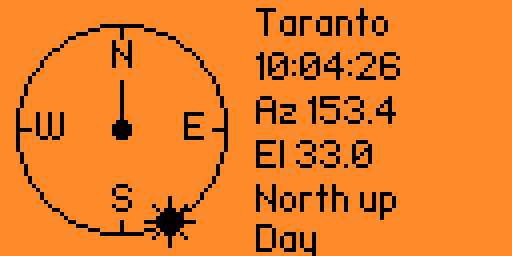

# Flipper-Zero-Solar-Compass

Flipper Zero offline compass apps.

**Solar Compass v1.0** is a solar-based compass application for the Flipper Zero, created by **Marcopiiit**.

The Flipper Zero does not have a magnetometer, so this application calculates the Sun's azimuth and elevation using the device's RTC clock and the geographic coordinates of a selected city.

By aligning the on-screen Sun marker with the real Sun, you can estimate the direction of North without additional sensors or hardware.

## Features

- **Solar Compass:** Calculates the Sun's position using date, time, and geographic coordinates.
- **Sun Up Mode:** Keeps the Sun marker at the top of the dial to help determine North.
- **North Up Mode:** Keeps North fixed at the top and displays the Sun's calculated compass bearing.
- **Multiple Cities:** Choose from 24 predefined cities worldwide.
- **Time Zone Settings:** Configure the UTC offset of the Flipper Zero clock.
- **Daylight Saving Time:** Select DST Off, DST On, or Auto EU.
- **Live Updates:** Refreshes the compass display every second.
- **Persistent Settings:** Automatically saves your city, clock offset, DST, and compass mode.

## Installation

1. Download or compile the `solar_compass.fap` application.
2. Connect your Flipper Zero to your computer.
3. Open qFlipper or your preferred Flipper file manager.
4. Copy `solar_compass.fap` to:

   `/ext/apps/Tools/solar_compass.fap`

5. Safely disconnect your Flipper Zero.
6. Open **Applications → Tools → Solar Compass**.

The application can also be installed using a compatible Momentum firmware development environment.

## How to Use

### 1. Configure Settings

Open **Settings** from the main menu and configure the following options:

- **City:** Select the city closest to your actual location.
- **Clock:** Set the UTC offset corresponding to the Flipper Zero's clock.
- **DST:** Choose the appropriate daylight saving time setting.
- **Mode:** Select Sun Up or North Up.

For Italy, the usual settings are:

- Clock: `UTC+1` during standard time.
- DST: `Auto EU`.

During daylight saving time, the application automatically adds one hour when Auto EU is selected.

**Important:** The Flipper Zero's date and time must be correct.

### 2. Find North

1. Go outdoors where the Sun is visible.
2. Select **Start** from the main menu.
3. Hold the Flipper Zero horizontally.
4. Use **Sun Up** mode.
5. Rotate the device until the Sun marker at the top of the dial aligns with the Sun's actual direction.
6. Read the `N` marker on the dial to estimate North.

Never look directly at the Sun to align the device. Use a safe indirect reference, such as the direction of a shadow.

### 3. Understand the Display

The compass screen displays:

- **City:** The currently selected location.
- **Time:** The Flipper Zero's current RTC time.
- **Az:** The calculated solar azimuth in degrees.
- **El:** The calculated solar elevation in degrees.
- **Mode:** The active compass display mode.
- **Day / Night:** Indicates whether the calculated solar elevation is above the horizon.

### 4. Controls

| Button | Function |
|---|---|
| Left | Select the previous city |
| Right | Select the next city |
| OK | Switch between Sun Up and North Up |
| Back | Return to the previous menu |

## Compass Modes

### Sun Up

The Sun marker stays at the top of the dial, while the cardinal directions rotate according to the calculated solar azimuth.

Use this mode outdoors to estimate North by aligning the marker with the real Sun.

### North Up

North remains fixed at the top of the dial, while the Sun marker indicates the calculated solar bearing.

Use this mode to estimate the Sun's direction when North is already known.

## Available Cities

The application includes the following predefined locations:

- Taranto
- Roma
- Reykjavik
- Svalbard
- Moscow
- Cairo
- Nairobi
- Cape Town
- Dubai
- Mumbai
- Singapore
- Beijing
- Tokyo
- Sydney
- Auckland
- Honolulu
- Anchorage
- Los Angeles
- Mexico
- New York
- Lima
- Rio
- Buenos Aires
- Ushuaia

## Settings Storage

Application settings are stored on the Flipper Zero at:

`/ext/apps_data/solar_compass/settings.bin`

The selected city, UTC offset, DST configuration, and compass mode are saved automatically and restored when the application starts.

## Limitations

- The application does not use a magnetic sensor or GPS.
- The selected city must reasonably match your actual geographic location.
- Incorrect RTC time, UTC offset, or DST settings can produce inaccurate results.
- The Sun must be above the horizon for practical solar alignment.
- The calculated direction is an estimate and may be affected by the accuracy of the astronomical calculation and the device's orientation.
- The application cannot provide a reliable magnetic compass reading at night or when the Sun is not visible.
- It is not intended for precision navigation or safety-critical use.

## Requirements

- Flipper Zero
- Compatible firmware supporting external applications, such as Momentum
- `solar_compass.fap` application or the source code and a compatible build environment

## Author

**Marcopiiit**

## Version

`1.0`
